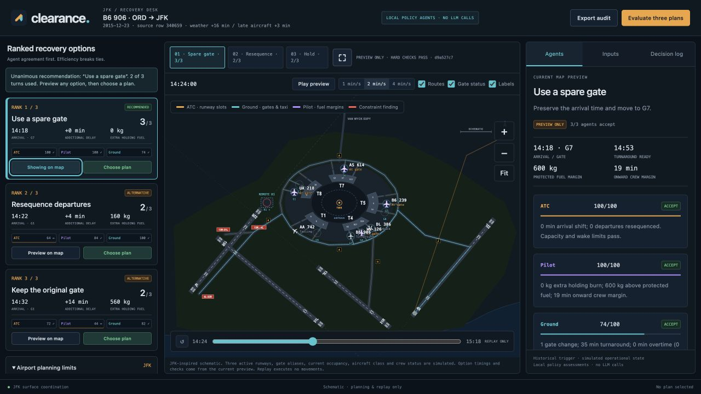

# Clearance

Clearance presents three airport recovery options, independent ATC/Pilot/Ground assessments and a map replay for a human to compare before selecting a plan.

The workspace keeps the JFK map in the center, ranked options on the left, and an inspector on the right. The inspector’s Agents, Inputs and Decision log tabs keep all controls on the same page. Each side panel scrolls independently. Smaller screens stack the panels below the map.



## Run

Requires Node.js 22+. No package install or network connection is needed after downloading this source bundle.

```sh
node src/server.mjs
```

Open http://127.0.0.1:4173. On this Mac, `start.command` also locates the bundled Codex Node runtime. The server listens on loopback only.

## Demonstration

1. Select **Evaluate three plans**. The default historical trigger is B6 906, ORD → JFK, 23 December 2015, source CSV row 340659.
2. Compare **Use a spare gate**, **Resequence departures**, and **Keep the original gate**. The default scenario has three hard-valid options, ranked by acceptance count: 3/3, 2/3, 2/3.
3. Each card shows every agent’s decision, efficiency score and rationale, plus arrival time, assigned gate, additional delay, holding fuel, turnaround readiness and ground overtime.
4. Select **Preview on map**, then **Expand map**. Switch the three map tabs and scrub the replay. Reassignment changes the arrival’s gate route. Holding adds an orbit. Resequencing changes two departure timings. The target aircraft then taxis, turns around and departs onward.
5. Select **Choose plan**. This records a human planning choice separately from the recommendation. A validated alternative may carry preference objections. A hard constraint cannot be overridden. Nothing is physically executed.
6. In **Scenario inputs**, make G7–G9 unavailable. Old options and human choice are cleared. Re-evaluate: after three turns with no unanimity, deterministic fallback recommends the validated resequencing plan. The spare-gate option is blocked.
7. With spare gates unavailable, set assumed arrival fuel to 1,500 kg. No option is hard-valid; selection is disabled and the UI requests human review.
8. **Test timeout fallback** bypasses agent messages. No acceptance count or efficiency assessment is fabricated. Export the JSON audit for source facts, assumptions, comparisons, hashes, agent messages and human selection.

## Historical data and constraints

The complete organizer flight CSV is bundled unchanged at `data/flights.csv`. It contains 358,774 records, all satisfying `WEATHER_DELAY > 15 OR LATE_AIRCRAFT_DELAY > 20`. There are 6,524 non-cancelled, non-diverted arrivals with destination JFK. The UI exposes 100 deterministic examples from this group. It does not claim the examples reconstruct the full airport schedule.

Source: https://jpvccqhcdjfupuquwnwc.supabase.co/storage/v1/object/public/experience-datasets/autonomous-sg-2026/challenge-2-flights.csv

`data/flights-index.json` retains exact original row numbers, source fields, source URL and SHA-256. Example order prefers weather-disrupted flights with moderate departure delay and an ETA near 14:00, then source row order. A source row is the disruption trigger. Baseline scenario ETA is scheduled arrival plus nonnegative departure delay, without adding arrival delay again. This simple estimate is an explicit scenario assumption. Actual historical arrival is displayed separately and is not used to claim a measured improvement.

The unchanged supplied workbook is in `reference/challenge-2-operational-constraints.xlsx`; all four sheets are extracted into `data/operational-constraints.json`. Runtime limits include JFK’s synthetic three active runways, 70 gates, three spare gates, aggregate 60 movements/hour and 35-minute turnaround. Wake timing uses the leader/follower table, including its default pair. Fuel and crew values are parsed from the workbook rules.

Regenerate the compact input files with Python’s standard library:

```sh
python3 src/build-data.py
```

`data/airports.csv` and `data/airlines.csv` retain the original supplied lookup files. Their licenses and organizer material provenance are separate from the application’s MIT source-code license.

## Explicit additional assumptions

The CSV has no current gates, complete airport traffic, aircraft type, onboard fuel or crew report times. The scenario therefore declares these assumptions in the interface and audit:

- One historical arrival is surrounded by six synthetic departures and synthetic background runway demand. Background gate occupancy represents the rest of the airport; the delayed-only dataset cannot reconstruct unaffected flights.
- G1 is occupied until minute 44. G7–G9 are the three initially spare gates. Resequencing two departures releases G1 at minute 34.
- The target uses an assumed narrowbody/Large wake class and 6,000 kg trip fuel. Workbook holding burn is 2,400 kg/hour. The 45-minute spare arrival allowance includes the protected 30-minute final reserve. The 5% trip-fuel contingency is carried separately and protected. Default arrival fuel is 2,100 kg, with 1,500 kg protected and 600 kg discretionary.
- Target crew has worked 690 minutes at decision time and is assumed to operate the onward departure. Ground crew has worked 410 minutes. Turnaround takes at least 35 minutes, followed by six minutes for onward pushback/taxi. Overtime is allowed and costs 1.5 times a normalized wage per minute.
- Three active runway aliases, four minutes of arrival taxi, departure fuel/tug assumptions and gate aliases are simulated. Capacity is enforced over rolling 60-minute windows across modeled background, arrivals and departures.
- Taxi paths, turbulence and passenger connections are not claimed as validated operational constraints. No corresponding data was provided. Geometry is illustrative, not an operational airport chart.

## Independent agents and agreement

The recovery desk currently uses **three separate local policy agents; it makes no LLM calls**. Each role has its own assessment function and history. Its efficiency opinions are transparent policy calculations, not model confidence, probabilities or measured performance.

Each turn contains exactly one structured message per role covering all three options. Turn one supplies preferences and assessments. The next turn shares peer preferences and confirms the same option hashes. An option has consensus only when all three accept its exact plan and scenario identity. The default completes in two turns (six messages). Runs stop after three turns (nine messages).

Hard validity takes precedence in ranking. Valid options then rank by ACCEPT count, lowest agent score, mean score, arrival delay and stable ID. Preference acceptance requires a score of at least 70/100:

- ATC: max(0, 100 − 2 × arrival delay minutes − 14 × resequenced departures).
- Pilot: max(0, 100 − 4 × holding minutes).
- Ground: max(0, 100 − 26 × gate changes − 2 × overtime minutes).

The weights and threshold are disclosed application choices, not organizer constraints. A hard breach produces VETO regardless of efficiency. A preference objection produces COUNTER while keeping a hard-valid alternative available to the human. Consensus applies to the recommended option, not automatically to every alternative.

After three turns with no consensus, a deterministic fallback minimizes arrival delay + holding fuel / 40 + 4 × gate changes + 3 × resequenced departures + 2 × overtime. It chooses only from validated options. Failure means none of these three strategies yielded a valid option; it is not a proof of global infeasibility or optimality.

## Chain collisions

Evaluation also checks whether a recovery option cascades into other disrupted arrivals. A chain is every arrival reachable from the selected flight through overlapping claims on spare gates, runway slots and onward departures: A clashes with B, B with C. It is not an hour bucket. Most of the 100 example flights have no chain. B6 717 and B6 584 do.

For each valid option, the chain is served in every order that keeps safety tiers in sequence (emergency, fuel, crew, spare-gate need, routine). Each flight takes its cheapest option that fits what earlier flights already claimed: spare gates held until turnaround clears, one landing per minute on runway 4R, one departure per minute on runway 4L, and the same-tail onward JFK departure that day. A taken slot pushes a flight a minute later, and a late aircraft passes its delay to its onward flight. The lowest-cost order wins, and ties keep the urgency order (tier, then least slack, then earliest ETA).

The result changes the evaluation in three disclosed ways. An option that leaves another chained arrival without any feasible option ranks behind options that do not, and cannot be unanimous consensus. The knock-on cost on other arrivals breaks ties before arrival delay and is added to the fallback cost. Each option card and the selection record show the serve position and knock-on. Chain results are a system check, not a fourth agent. Weights are disclosed product choices. The onward-flight link is partial because the CSV lists delayed flights only.

**Stress test** (Scenario inputs) adds three real arrivals re-timed to land 1–3 minutes after the selected flight. Their fuel, crew and onward facts are real. The collision itself is not a historical event and is labelled as such.

## Human choice and audit

Preview and human selection are separate. Choosing a 2/3 alternative records `human_selected_validated_alternative`, with the unresolved preference objections. It never becomes agent consensus by relabeling. The server revalidates the option and verifies a hash bound to the entire scenario and plan. Changed inputs create a new session, clear old reviews/selection and require re-evaluation. Comparisons and choices are retained in an exportable session audit. Sessions are in memory and reset on server restart or page reload.

## Map and existing sandbox

The navy/slate palette and JFK schematic are adapted from the supplied HTML, preserved in `reference/JFK Airfield Agents.html`. ATC is amber, Ground cyan and Pilot violet. Gate aliases are simulated: G1 T8/8, G2 T8/12, G3 T4/B24, G4 T4/B27, G5 T5/9, G6 T7/G7, G7 T4/A5, G8 T5/14, G9 T1/3. Three runways are active in the scenario and the fourth is marked inactive context.

Every option has its own map payload. Switching resets the visualization clock and route/stand state to the selected option. Hard-invalid options are inspectable but cannot be replayed or chosen. A human-chosen option is explicitly marked. Replay does not advance the authoritative planning state or execute movements.

The earlier departure sandbox remains at `/operations.html`. Its optional Claude/Gemini adapters and original demonstration are preserved there, with documentation in `reference/DEPARTURE-SANDBOX.md`. That legacy sandbox uses its original simplified fixture; it is not the updated workbook-compliant recovery workflow. Live-provider adapters are not connected to the new three-option recovery desk. No live LLM performance has been claimed or tested without credentials.

## Verification and layout

```sh
node --test test/*.test.mjs
```

Tests cover domain checks, exactly three messages per turn, independent acceptance/ranking, exact fuel/notice boundaries, fallback, blocked selections, scenario-bound hashes, source provenance, HTTP exports, and arrival/taxi/turnaround/onward replay boundaries, chain linking, serving order, stranded options and the stress test.

- `src/recovery.mjs`: workbook-backed scenario, three strategies, validator, role agents, ranking, fallback and human-choice validation.
- `src/chain.mjs`, `src/triage.mjs`: chain collisions, serving order and urgency tiers.
- `data/onward-index.json`: same-tail onward JFK departure for each indexed arrival.
- `src/build-data.py`: reproducible extraction/indexing of original inputs.
- `src/server.mjs`: loopback API and static files.
- `public/recovery.*`: recovery comparison interface.
- `public/jfk-plan.js`, `public/jfk-replay.mjs`: map bridge and tested replay helpers.
- `src/domain.mjs`, `src/agents.mjs`, `src/providers.mjs`: preserved departure sandbox.
- `data/`: unchanged source CSVs and compact derived inputs.
- `reference/`: unchanged supplied HTML/workbook and sandbox documentation.
